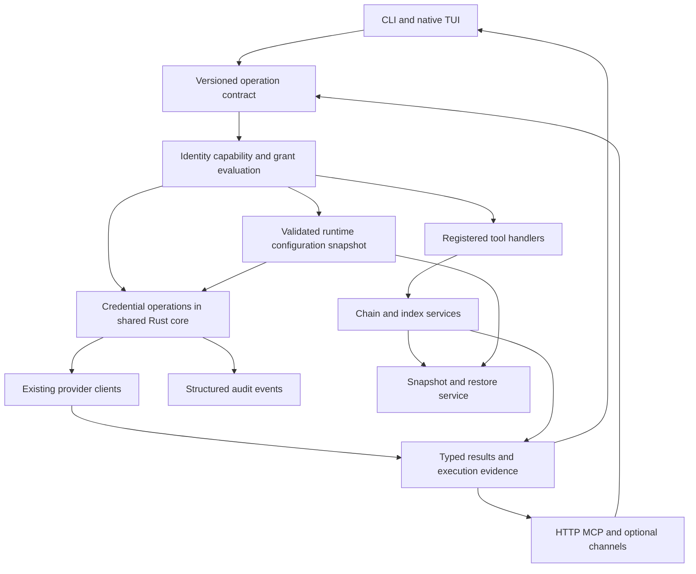

# Memphis runtime refactor architecture

Status: proposed implementation contract for S1–S9. Existing behavior and completed host changes are recorded separately in AUDIT and OPERATIONS. The design preserves the current vault v2 format and chain history while replacing duplicate decisions behind stable interfaces.

## Runtime responsibilities



This is an in-process shared-core design, not a new daemon or network vault service. Native Rust and NAPI call the same credential operations. TS retains transport adapters, UI integration and existing application orchestration. Shared DTOs and fixtures define semantics at language boundaries; they do not require rewriting every provider client at once.

| Component             | Owns                                                                                    | Must not own                                                                              |
| --------------------- | --------------------------------------------------------------------------------------- | ----------------------------------------------------------------------------------------- |
| Runtime configuration | Canonical absolute paths, effective values, source provenance, configuration generation | Silent cwd fallback, plaintext values in status payloads                                  |
| Credential core       | Load, authenticate, decrypt, rotate, cache invalidation and typed credential state      | User interaction, arbitrary network destinations, unrestricted model-facing secret return |
| Policy evaluator      | Principal, surface, capability, grant scope, expiry, revocation, decision reason        | Inferring authorization from an LLM statement or tool name alone                          |
| Provider client       | Endpoint validation, authenticated request, model error interpretation, cancellation    | Generic vault export, silently claiming credential presence is remote health              |
| Tool manifest         | Schemas, tier, capability, effect, executor, supported surfaces                         | A second hand-maintained native authorization list                                        |
| Audit recorder        | Typed allow/deny/start/finish events, correlation, retention and file permissions       | Plaintext, secret hashes, arbitrary exception serialization, writes under chains          |
| Memory services       | Chain append/verify, derived indices, read/write ownership, migrations                  | Uncoordinated sidecar writers or hiding index corruption as an empty index                |

## Configuration and rotation transaction

All entrypoints resolve one runtime root, data root, database, audit log, WAL, vault state and entries path. User-selected work directories remain work directories; launching from `~/Work` must not relocate runtime state. Config reads report where a value came from without revealing it.

**S1.5 decision, 2026-10-18:** distinguish the accepted in-process configuration
epoch (`MEMPHIS_CONFIG_GENERATION`) from persisted vault identity. A running
process and a fresh process must select the same committed files and credential;
their local epoch numbers need not match. Persisted identity comes from the
resolved state path and exact state bytes under the shared journal locks, with
the effective pepper included only in the private cache key. These digests are
never public diagnostic fields. Adding a separate durable numeric counter would
introduce another transactional file without improving detection of replacement
or legacy writers; preserve the existing v1/v2 storage formats instead.

An accepted environment swap invalidates the TS key immediately and advances
its local epoch. Dry runs, rejected changes and no-ops retain both. TS and native
caches retain only the current derived handle and evict it on changed inputs or
a failed state load. Entries are selected again from disk; decrypted credential
values are not cached. Both readers capture state under the journal locks, derive
the key outside those locks, then validate the captured identity under the locks
before selecting and decrypting the current entry. Retry a changed snapshot at
most three times; never publish an old key under a new identity.

Pepper remains cold configuration. An external pepper rotation invalidates a
running process's old state handle and produces `VAULT_STATE_AUTH_FAILED` until
that process restarts with the committed configuration. Reads do not silently
replace an explicit environment credential from dotenv. The dedicated CLI
rotation already returns restart and credential-check instructions. The tests
must compare warm TS/native readers with a fresh configuration load; matching
process-local counters are not acceptance evidence.

Generic config mutation rejects changes to an existing vault's pepper with a typed `ROTATION_REQUIRED` result. The dedicated rotation operation validates the current state, acquires a writer lock, stages the new wrapped state and environment update, verifies every affected entry, flushes files and directories as supported, and commits a recovery journal. A two-file rename is not assumed to be atomic. Startup reconciles an interrupted transaction before normal service entry. No fallback creates a fresh master key.

Existing state/entry snapshots remain available until verification succeeds. Cache keys include configuration generation and vault identity; rotation invalidates both Rust and TS caches. Recovery distinguishes absent state, absent entry, malformed state, failed state authentication, failed entry authentication and integrity metadata mismatch. Cryptography alone cannot reliably distinguish a wrong pepper from corrupted authenticated state, so the current public code is `VAULT_STATE_AUTH_FAILED` unless additional recovery evidence establishes the cause.

## Credential operations and result shape

Expose operations with fixed semantics, not a generic model-supplied callback:

- `credential.inspect`: entry presence and metadata permitted by the principal's scope; no decrypt required.
- `credential.probe`: authenticate state and decrypt a configured credential internally; return only a validated diagnostic DTO.
- `provider.probe`: use an existing configured provider adapter with a fixed harmless request and bounded cost.
- `credential.rotate` and `credential.recover`: explicit maintenance operations with their existing mutation and recovery authorization requirements.
- Human secret export, where retained for compatibility, remains a distinct privileged surface and is not advertised as an agent diagnostic.

Proposed example, not an observed API response:

```json
{
  "schemaVersion": 1,
  "operation": "provider.probe",
  "provider": "minimax",
  "credentialState": "decryptable",
  "verification": {
    "level": "generation",
    "status": "passed",
    "checkedAt": "<ISO timestamp>",
    "durationMs": 900,
    "cached": false
  },
  "requestId": "<opaque correlation id>"
}
```

Verification levels are `configuration`, `local-decryption`, `remote-authentication` and `generation`. Status is `passed`, `failed`, `not-run` or `unknown`. If a provider has no authentication-only endpoint, one tiny generation verifies generation and authentication together; label the actual operation. Return an explicit failure code for absent credential, rejected authentication, forbidden model, timeout, rate limit, policy denial or canceled request. No overall `verified=true` may erase which level ran.

The DTO contains no secret prefix, suffix, length, plaintext hash or reconstructable fragment. Credential identity uses an opaque entry ID/version when necessary. A caller may request a configured provider identifier, not an arbitrary destination to receive an Authorization header. Cross-origin redirects must not forward credentials.

### What the boundary guarantees

`withVaultSecret<T>` currently permits `fn` to return anything, including its input. Renaming the result or omitting a `plaintext` property is insufficient. Fixed operations, schemas with unknown fields rejected, sanitized errors, recursively constrained audit DTOs and transport-level sentinel tests establish the intended non-disclosure boundary.

Rust secret containers should avoid `Debug`/serialization and use controlled buffers with best-effort clearing. JavaScript strings, copied request buffers, TLS libraries and process memory prevent an absolute claim that plaintext never exists outside a callback or that every copy is zeroized. The product guarantee concerns allowed outputs, logs, prompts, persistence and destinations; it is not a claim of resistance to a fully compromised runtime process.

### Audit and quota semantics

Use one event schema across native and TS operations: operation, subject, surface, opaque credential ID, request ID, policy decision, outcome code, elapsed time and timestamp. Record authorization separately from operation completion, including async failures and cancellations. Never serialize an arbitrary thrown object or HTTP request headers. New writers append outside chain directories; existing audit history remains intact.

A proposed initial remote-probe quota of ten requests per credential/principal per fifteen minutes is a tuning default, not an exfiltration defense. Authenticate before revealing key-specific state; account for multiple processes and restart if persistence is required. Separate remote cost control from cheap local inspection, expose a safe `retryAfterMs`, and avoid allowing one client to exhaust every other client's quota.

## Authorization and manifest

The decision is the intersection of authenticated principal, surface policy, tool capability, action effects, resource scope and a valid grant. A tool tier is one input. The current process-local login cache cannot be promoted into a universal session mechanism.

| Operation                                         | Required policy meaning                                 | Operator experience                                                              |
| ------------------------------------------------- | ------------------------------------------------------- | -------------------------------------------------------------------------------- |
| Read runtime health or non-secret metadata        | Existing read capability for the surface                | Complete within the task's existing authorization                                |
| Probe configured local credential                 | Credential-use capability and scoped principal          | No repeated passphrase prompt solely because a tool is tier 2                    |
| Test already configured MiniMax                   | Existing provider-use/network grant and bounded request | Report that a real request ran and what it established                           |
| Read code / permitted local edits                 | Existing repository and tool permissions                | Do not invent an additional consent step based on registry maintenance           |
| Change provider/destination or broaden privileges | Grant covering that actual change                       | Ask only when the change falls outside current authorization                     |
| Rotate keys / destructive restore / raw export    | Explicit maintenance or export authorization            | Present the concrete scope, recovery artifact and remaining approval requirement |

Generate native metadata, MCP schemas and documentation from a versioned manifest. Every advertised tool must map to an executor and policy, and every executable operation must be classified. Unknown capability or schema version is denied explicitly. Existing intentionally public tools receive an explicit tier/capability; no implicit `_ => 0` authorizes future additions. Denial results name the actual gate and the narrow remedy, without suggesting global tier escalation as the universal fix.

Session grants are bound to a principal, surface/session, scope, issue time, expiry and revocation version. An implementation decision on persistence must keep restart behavior explicit; it must not silently extend privileged access. Server-held grants or signed short-lived handles are preferable to a global boolean. The model never receives a passphrase to copy into a tool call.

## Native conversation and context

Extract `chat.rs` incrementally into session storage, context assembly, tool catalog, tool execution, streaming and cancellation modules. Keep the existing public facade while moving one responsibility per change. Share fixtures and semantics with TS compaction before attempting a shared execution engine.

Each request records token attribution for fixed instructions, task state, memory retrieval, recent dialogue, tool schemas and tool outputs. Persist the task goal, accepted decisions, evidence references and pending operations separately from the rolling transcript. Compact completed segments, cap repetitive tool output with retrieval handles, deduplicate repeated source excerpts, and preserve tool call/result pairs. Restore the same task checkpoint after crash or restart.

The reported 105k-token prompt establishes a need to measure; it does not establish which component dominates. A provisional target is at least 50% fewer input tokens on the reproduced transcript, with all task-continuity and authorization tests passing. Do not impose arbitrary task-duration cutoffs or discard uncompleted work to hit that target. Small credential probes bypass the conversational memory pipeline entirely.

## Memory and recovery

Chains remain durable source records; exact search, embeddings and case indexes are rebuildable projections with explicit format versions and source watermarks. One path contract is consumed by CLI, TS daemon and native TUI. Readiness checks inspect the actual index format rather than counting files or assuming every persistence file is a JSON object.

Backups declare coverage: chain data, SQLite snapshots including committed WAL content, config, identity and separately protected credential material. Standard non-secret archives and credential recovery packages have different handling. A complete recovery set is identified in a manifest, never inferred from a successful tar checksum. Do not place a plaintext pepper alongside ciphertext in an exportable public archive.

Take SQLite snapshots through the SQLite backup API, coordinate chain append watermarks, and record the consistent generation. Restore into an isolated directory with networking disabled; verify checksums, chain links, database integrity, index readability, credential authentication and public/private identity correspondence before switching live paths. A manifest listing is only archive validation. Scheduled-backup status comes from persisted job evidence, not a second process-local timer boolean.

## Migration and rollout

1. Capture old behavior using synthetic secrets, fixture databases and sanitized transcripts. Record current source/build provenance.
2. Add versioned DTOs and compatibility adapters around existing implementations. Probe both paths on fixtures only; live secrets never enter shadow logs.
3. Migrate one operation at a time, keeping old data readable and performing no silent rewrites at boot.
4. Canary the local Omarchy installation with its private recovery bundle and explicit configured paths.
5. Validate a clean install and an upgrade from an existing vault, including interrupted transactions and restart.
6. Remove duplicate implementations only after parity and recovery evidence exists. Publish migration and rollback instructions with the release artifact.

Documentation, schema changes and native/TS builds move together. Rollback may select an older implementation only if it can read the persisted schema; otherwise recover through the verified staged snapshot rather than downgrading blindly.
