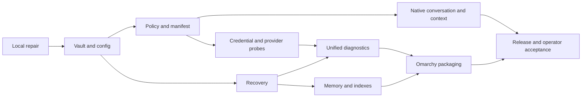

# Memphis repair and refactor sprints

Execution status 2026-10-18. S0 is accepted on this host. S1.1–S1.3 have
verified implementation slices; S1.4 is partially deployed and S1.5 is locally accepted. Unchecked tasks may
already have code in the mixed checkout, but do not have complete acceptance.
Use [EXECUTION.md](EXECUTION.md) for dated evidence and [VALIDATION.md](VALIDATION.md)
for gaps. A checked task does not close its sprint or its entire validation row.

Every task needs a named implementer and reviewer when selected. Suggested owners below identify the component role, not an assigned person or an instruction to launch parallel agents. Keep each PR independently reviewable; stop a migration at its failing acceptance gate and continue unrelated safe work.

## Dependencies and priorities

| Sprint | Priority | Effort                | Primary role                           | Findings                            |
| ------ | -------- | --------------------- | -------------------------------------- | ----------------------------------- |
| S0     | P0       | Completed host repair | Runtime operator                       | F01, F10–F12                        |
| S1     | P0       | 5–8 days              | Vault/config maintainer                | F01–F05, F09–F10, F20               |
| S2     | P0       | 4–7 days              | Policy and native interface maintainer | F04, F06–F07, F22                   |
| S3     | P1       | 3–5 days              | Provider maintainer                    | F03, F05, F08–F09, F22              |
| S4     | P0       | 4–7 days              | Persistence/recovery maintainer        | F15–F17, F21                        |
| S5     | P1       | 3–5 days              | Runtime diagnostics maintainer         | F08, F12–F15, F21                   |
| S6     | P1       | 5–9 days              | Native TUI/conversation maintainer     | F18–F19                             |
| S7     | P1       | 4–7 days              | Chain and index maintainer             | F10, F13, F16–F17                   |
| S8     | P1       | 3–5 days              | Packaging/Omarchy maintainer           | F10–F12                             |
| S9     | P1       | 3–5 days              | Release/docs maintainer                | F19–F20 and all acceptance evidence |

The table retains the original October 12 estimates: 34–58 engineering days for S1–S9 before the subsequent work. This is not an estimate of remaining effort. Re-estimate after S1 acceptance and the S2 manifest inventory. Data migration and authorization parity determine the remaining critical path.

## S0 Local Omarchy recovery

**Result:** restore usable local service and retain evidence before product refactoring.

- [x] Diagnose exit 102 and verify the saved vault against existing env backups without printing secrets.
- [x] Restore the matching pepper, preserve the original encrypted entry, and clear references to unconfigured optional providers/channels.
- [x] Pin DB, audit, queue and vault paths for launches outside the checkout.
- [x] Install user-owned Omarchy dispatch/default-agent adapters, direct Memphis launcher, desktop entry and session PATH handling.
- [x] Use a systemd drop-in with stable Node 22 alias, normal CLI boot entrypoint and private runtime umask; preserve restart protections.
- [x] Initialize the missing DID through the supported command, storing its seed encrypted.
- [x] Verify real MiniMax generation, native TUI check, required doctor checks, and private recovery material.

**Acceptance:** results in VALIDATION, no secret reset, zero required doctor failures, service active and enabled. This closes the incident locally; it does not close S1–S9 or certify a reboot that was not performed.

**Rollback:** user-integration files have pre-change copies. Restore integration changes selectively; do not blindly restore the old env file, which contains the mismatched pepper. Use the verified recovery set for state recovery.

## S1 Vault lifecycle and runtime configuration

**Entry:** S0 evidence and recovery copy available; identify ownership of pre-existing changes.

**Goal:** no supported configuration operation can strand existing credentials or silently create a second runtime data root.

- [x] S1.1 Add a typed runtime path/config snapshot with source provenance and generation; use it from service, CLI and native configuration.
- [x] S1.2 Reject generic mutation/unset of an initialized vault's pepper; route intentional changes through the dedicated rotation operation.
- [x] S1.3 Implement recoverable multi-file rotation transactions: lock, stage, validate entries, flush, journal commit, recover after interrupted steps.
- [ ] S1.4 Consolidate credential load/decrypt/state error classification behind shared Rust operations with TS/NAPI compatibility adapters; preserve vault v2 reads.
- [x] S1.5 Make cache invalidation respond to config generation, state identity, rotation and secret replacement. Test both same-process and fresh-process reads.
- [x] S1.6 Honor configured custom credential references consistently in native and TS resolution.
- [ ] S1.7 Define safe audit DTOs; remove plaintext hashes from new diagnostic events and constrain nested error serialization. Inventory legacy sensitive outputs without printing values.
- [x] S1.8 Triage credential-like historical prose. Redact maintained documentation; establish whether rotation is necessary before changing any active secret. Keep a sanitized incident record.

**Code:** `src/infra/config/`, `src/infra/storage/rust-vault-adapter.ts`, `src/security/vault-boundary.ts`, `src/providers/index.ts`, `crates/memphis-operator/src/{config,runtime,provider}.rs`, `crates/memphis-vault/`, `crates/memphis-napi/`.

**PR slices:** config/path contract; transaction journal and rotation guards; shared credential facade/cache; alias parity and audit redaction. Do not combine crypto-format changes with a provider rewrite.

**Acceptance:** V01–V04 and V11. A failed pepper update leaves every original credential readable after restart. Interrupt every commit step on fixtures. Launches from home, Work and another project agree on paths. Synthetic secret sentinels never occur in results, logs or exceptions.

**Rollback:** retained old config generation and encrypted snapshot; reverse the transaction through its recovery journal. An unrecognized persisted schema blocks incompatible downgrade.

### S1 completion queue

The current implementer is Codex. This reconciliation was self-reviewed by Codex;
independent PR review is not claimed. Each implementation slice must record its
actual author/reviewer and source revision in EXECUTION before being called accepted.
S1.5, S1.6 and S1.8 are locally accepted as E18-CACHE/E18-ALIASES/E18-PROSE.
S1.7 has deployed audit/config/wallet/H3, HTTP, atomic-write and CLI error slices.
Native Debug is deployed after 475 Rust and 577 TS tests; full sentinel coverage remains.
Next: remaining S1.4/S1.7 and V01–V04/V11 acceptance.

| Order / task      | Bounded next change                                                                                                                                                                                       | Required evidence before closing                                                                                                                                                                                                                                                                                           | Existing assets to retain                                                                                                                         |
| ----------------- | --------------------------------------------------------------------------------------------------------------------------------------------------------------------------------------------------------- | -------------------------------------------------------------------------------------------------------------------------------------------------------------------------------------------------------------------------------------------------------------------------------------------------------------------------- | ------------------------------------------------------------------------------------------------------------------------------------------------- |
| 1 / S1.4          | Inventory the remaining raw-entry, metadata, boot, provider, CLI/HTTP/MCP and native readers; reconcile their documented error semantics with the shared state/entry readers. Fix only demonstrated gaps. | Same fixture selects the same newest entry and safe error across relevant surfaces. Cover missing state/entry, malformed JSON, bad fingerprint/authentication/text, pending journal and concurrent rotation. No fallback to an older entry.                                                                                | `vault-state-parity`, `vault-entry-parity`, `native-vault-snapshot`, `vault-concurrent-writers`, CLI/API/MCP tests; latest evidence E17-SNAPSHOT. |
| 2 / S1.5          | Define cache invalidation for an accepted config swap, state replacement, entry replacement and both rotations. Explicitly define long-lived process behavior after an external pepper rotation.          | Warm TS/native caches, replace each input, then compare same-process and fresh-process reads. Rejected/dry-run/no-op reloads keep the generation. An old cache cannot make an invalid pepper or old state succeed. Verify stale decrypted generations are evicted and that unchanged inputs retain the intended KDF cache. | `runtime-config-snapshot`, `config-hot-reload`, `vault-cache-collision`, native provider cache tests and E17-SNAPSHOT.                            |
| 3 / S1.6          | Reconcile the existing custom vault-reference changes across TS and native provider selection.                                                                                                            | Fixture with default and custom aliases, replacement/removal, missing and corrupt latest entries; both surfaces select the configured reference and report the same state.                                                                                                                                                 | `provider-vault-alias`, provider-key integration and native `provider.rs` tests.                                                                  |
| 4 / S1.7–S1.8     | Finish fixed audit/diagnostic output schemas and inventory maintained prose/history containing credential-like values.                                                                                    | Sentinels through success, nested failures, headers, callback misuse and async rejection remain absent from diagnostic/model-visible outputs. Trusted internal callbacks retain their documented contract. Report only locations/categories for historical findings; establish exposure before any active-secret rotation. | Existing audit allowlist, `vault-boundary` tests, S3 diagnostic DTOs. Append-only audit history remains preserved.                                |
| 5 / S1 acceptance | Complete V01–V04 and V11 at one declared source revision, including remaining failure modes and launch environments.                                                                                      | Disk-full and permission failures on disposable fixtures, cross-surface config mutation, home/Work/unrelated cwd/clean env/systemd path agreement, and same/fresh-process reads. Existing SIGKILL evidence does not imply power-loss testing.                                                                              | Six encrypted-rotation crash cases, journal migration, concurrent init/writer/reader fixtures and runtime isolation guards.                       |

S1.5 decision (2026-10-18): `MEMPHIS_CONFIG_GENERATION` is the accepted
in-process epoch. Cross-process equivalence means selecting the same committed
files and credential, with persisted vault identity derived from resolved paths
and exact state bytes under the journal locks. Do not add a third transactional
counter file or publish the private cache digest. External pepper rotation needs
a restart with the committed configuration; a running process must reject its
stale pepper. See the implemented contract in ARCHITECTURE and E18-CACHE evidence.

For each row: first capture a failing fixture where a defect exists, then make the
smallest compatible change; test in an isolated runtime; build outside live dist;
compare the intended artifact set; deploy with preserved rollback artifacts; check
API, required doctor checks, TUI and the configured provider after restart. Preserve
vault v1/v2 reads, journal migration and the existing Git index. Cut a thematic commit
from the verified change; a successful deployment alone is not a commit.

### Delivery sequence after S1

| Next scope | Start with                                                                                                                                | Exit gate                                                                                                                                                                |
| ---------- | ----------------------------------------------------------------------------------------------------------------------------------------- | ------------------------------------------------------------------------------------------------------------------------------------------------------------------------ |
| S2         | Reconcile actual dispatch/catalog/registry and existing native policy changes; then implement session/grant parity.                       | V05 passes for every executor; no unknown-tool allow path or cross-session grant reuse.                                                                                  |
| S4         | Inventory existing recovery coverage now; implementation follows the stable S1 contract. Validate the existing drill before extending it. | V08–V09 restore WAL-backed rows, chains, credential and matching identity in isolation; scheduler/retention evidence survives restart.                                   |
| S3 → S5    | Reuse existing diagnostics/provider code after policy and recovery contracts settle.                                                      | V03–V07 and V10: safe diagnostics, bounded provider probes, cancellation and one authoritative health model.                                                             |
| S6 → S7    | Establish sanitized token/continuity and concurrent-memory baselines before moving modules or changing index formats.                     | V12–V14 and remaining V11 assertions; ten PTY cycles, resumable operations and no lost committed memory.                                                                 |
| S8 → S9    | Prepare an isolated Omarchy host/VM and declare the release revision, supported scope and canary window.                                  | V15, all in-scope release gates, one scheduled backup cycle plus restart, documented warnings and rollback. Host reboot belongs to this isolated acceptance environment. |

The missing isolated Omarchy environment is a prerequisite for the later release
gate, not a reason to stop local S1–S7 implementation. Local health or a short
MiniMax canary does not substitute for a complete restore, VM/reboot test or
release observation window.

## S2 Tool manifest and authorization parity

**Entry:** S1 operation/config contract stable. **Goal:** identical operations receive explainable, scoped policy decisions across surfaces.

- [ ] S2.1 Version the tool manifest: input/output schema, tier, capability, effect, supported surface, executor and deprecation metadata.
- [ ] S2.2 Generate native authorization/catalog metadata, MCP schemas and docs from that contract. Validate every advertised and executable operation; reject unclassified additions.
- [ ] S2.3 Replace ambiguous process-global authorization assumptions with explicit subject/session/grant context. Specify expiry, restart, logout and revocation semantics.
- [ ] S2.4 Apply the same action policy to native dispatch, TS executor and MCP/HTTP registration while retaining deliberate surface restrictions.
- [ ] S2.5 Return structured denial reasons and the minimum required remedy. Remove blanket advice to raise global max tier.
- [ ] S2.6 Inventory raw vault-read entrypoints; keep explicit human export separate from diagnostic and provider-use capabilities.
- [ ] S2.7 Add tests for malicious tool output, prompt injection and attempted use of an unrelated session's authorization.

**Code:** `src/gateway/tool-registry/`, `src/gateway/tool-executor.ts`, `src/mcp/server.ts`, `src/infra/auth/operator-gate.ts`, `src/security/tier3-session.ts`, native `chat.rs`, tier generator and CI.

**PR slices:** manifest generation; explicit grant context; surface adapters; compatibility/deprecation cleanup.

**Acceptance:** V05. Existing permitted code reading does not acquire an invented password prompt. Denied actions stay denied through every executor. Grant expiry/revocation cannot be bypassed with a fresh process or another surface. The generator fails when a test tool lacks policy metadata.

**Rollback:** keep a versioned adapter for the old manifest during canary. Never roll back by restoring permissive unknown-tool defaults or disabling the authorization check.

## S3 Credential and provider diagnostics

**Entry:** S1 and S2. **Goal:** answer “is the credential usable?” and “did this provider respond?” without exposing credential fragments.

- [ ] S3.1 Implement `credential.inspect`, local `credential.probe`, and network `provider.probe` with fixed operation DTOs from ARCHITECTURE.
- [ ] S3.2 Reuse the existing MiniMax client. Add equivalent contract adapters for configured providers; do not create placeholder credentials for optional providers.
- [ ] S3.3 Split configuration readiness, local decryption, remote authentication and generation results. Include freshness/cache semantics and actual measured duration.
- [ ] S3.4 Add destination and redirect policy, cancellation, short bounded probe requests and provider-specific error mapping.
- [ ] S3.5 Record allowed/start/finish/cancel/deny audit events through the shared recorder. Handle async callbacks and exceptions without secret-bearing errors.
- [ ] S3.6 Add scoped quotas for remote probes where needed; persist counters when restart would defeat the policy. Document what the quota protects.
- [ ] S3.7 Expose the same safe diagnostic through TUI, CLI and authorized MCP/HTTP surfaces. Describe only genuinely supported operations to the model.

**Acceptance:** V03–V07. Wrong key, wrong model, 401, 403, 429, network failure, timeout and cancellation are distinct outcomes. Local probe never claims network success. A real request using a configured provider needs no fresh generic “A or B” approval when already covered by the task. Errors and tool transcripts contain no secret-derived prefix, suffix, length or plaintext hash.

**Rollback:** disable the new public probe adapter while keeping existing provider chat operational; retain diagnostic records and typed failures.

## S4 Complete recovery and scheduler truth

**Entry:** S1 storage contract. Start recovery coverage review before any other data migration.

- [ ] S4.1 Inventory the entire recovery set: chains, DB and WAL, case index, embeddings, config, identity, grants where applicable, credential state and required external key material.
- [ ] S4.2 Define separate standard archive and protected credential recovery package formats, with a manifest identifying which capabilities each can restore.
- [ ] S4.3 Snapshot SQLite with its backup API; use a documented consistency watermark for chains/indexes. Do not interpret tar's changed-file warning as snapshot consistency.
- [ ] S4.4 Replace list-only drills with extraction into an isolated directory and actual chain, SQLite, index and credential checks. Disable network egress during the drill.
- [ ] S4.5 Make one scheduler the authority for backup cadence. Persist success, failure, coverage, drill outcome and freshness across process restarts.
- [ ] S4.6 Align scheduler task status schemas and crash/retry transitions; reproduce the observed `lastStatus` warning with a fixture.
- [ ] S4.7 Test retention by backup class; never delete the last verified complete recovery set or operator-created recovery directories.

**Code:** backup CLI, `scheduled-backup.ts`, `scheduler-builtins.ts`, scheduler state schemas, SQLite storage, restore runbooks.

**Acceptance:** V08–V09. A fixture host restores into a fresh directory, reads expected memory/session rows, decrypts a synthetic credential and matches the public identity to its encrypted seed. Failure cannot modify the live source. Next scheduled run, latest success and retention survive restart. No duplicate daily timer is enabled.

**Rollback:** leave previous archives immutable, disable only the new scheduling path, and restore the last verified config generation. Do not use the first unverified new-format archive as a rollback source.

## S5 One diagnostic model

**Entry:** S3 and S4. **Goal:** health, readiness, doctor and native TUI describe the same state and its evidence level.

- [ ] S5.1 Extract runtime diagnostic services from the doctor monolith and make presentation a separate layer.
- [ ] S5.2 Read canonical embedding metadata, operator recovery config, identity and scheduler state instead of environment/directory heuristics.
- [ ] S5.3 Use explicit `not-configured`, `optional`, `degraded`, `failed`, `healthy`, `unknown` states with check age and source.
- [ ] S5.4 Define exit code policy: required failures fail doctor; optional absent integrations do not. Warnings must recommend supported, non-destructive next steps.
- [ ] S5.5 Ensure frequent health reads do not make paid provider requests or recompute expensive KDF/index scans unnecessarily.
- [ ] S5.6 Publish a structured repair preview. For a proposed repair, include actual files/records affected, backup and validation steps; distinguish operator setup from product defects.

**Acceptance:** V10. A populated native index cannot be reported as empty by doctor. Stored recovery configuration is recognized without exposing its verifier. Cron-enabled backups remain enabled in health after restart. A localhost-only setup without voice, Telegram, Matrix, training or Brave passes its declared baseline.

**Rollback:** preserve old CLI output compatibility through formatting adapters while reverting a diagnostic backend; never invent a healthy result to keep exit code zero.

## S6 Native conversation and context refactor

**Entry:** S2; use S3 telemetry as available. **Goal:** reduce duplicated context and split native responsibilities without interrupting long tasks.

- [ ] S6.1 Capture a sanitized reproduction of the reported 105k-input-token turn. Attribute tokens by prompt segment, history, retrieval, schemas and tool output.
- [ ] S6.2 Extract session store, context builder, catalog, executor, provider stream and cancellation from `chat.rs` behind stable public APIs.
- [ ] S6.3 Share compaction semantics and fixtures with the TS context service. Preserve pending tool pairs, explicit operator instructions and outstanding task state.
- [ ] S6.4 Persist resumable goal/checkpoint state separately from the display transcript. Verify restart during a pending operation cannot silently repeat a destructive tool.
- [ ] S6.5 Deduplicate repeated file excerpts, bound individual tool output and retain retrieval references. Keep exact artifacts outside prompt history.
- [ ] S6.6 Expose actual provider token usage separately from estimates, request latency separately from local checks, and compilation/runtime provenance in diagnostics.
- [ ] S6.7 Exercise raw-terminal input, resize, cancel, exit and worker panic paths; retain existing native TUI improvements already in the working tree.

**Acceptance:** V12–V13. Candidate target: at least 50% fewer input tokens on the reproduced transcript, with all continuity, evidence and authorization assertions preserved. The target is provisional until the baseline is reproduced. Ten PTY launch/exit cycles leave the terminal restored and no orphan workers. Canceled requests stop provider/tool work according to contract.

**Rollback:** switch to the previous context assembler using the preserved raw transcript and checkpoint; keep the session schema backward-readable during rollout.

## S7 Memory and index consistency

**Entry:** S4; coordinate context interfaces with S6. **Goal:** memory survives concurrent use, restart, reindex and recovery with known provenance.

- [ ] S7.1 Inventory append paths and reproduce concurrent CLI/native/daemon writes with isolated chains; distinguish historical reports from current regressions.
- [ ] S7.2 Establish one writer/locking contract, sequence allocation and crash durability behavior. Keep non-chain audit data outside chains.
- [ ] S7.3 Version semantic persistence metadata and expose document count, dimension, model and source watermark through the shared core.
- [ ] S7.4 Define exact search/case/embedding rebuild transactions and mismatch handling. Prevent silent embedding loss during multi-process flushes.
- [ ] S7.5 Test chunking and retrieval for large multilingual records; preserve parent-block references and deduplicate results.
- [ ] S7.6 Make maintenance commands use resolved paths and preview scope. Preserve user memory even when a derived index is corrupt.

**Acceptance:** V11, V14. No invalid blocks or lost committed entries in concurrent/kill/restart fixtures. Rebuilt indexes match expected source records. Corrupt projections can be rebuilt without modifying source chains. Polish queries and long records pass a checked-in retrieval fixture.

**Rollback:** point readers back to the prior index generation and replay from the last consistent chain watermark. Never overwrite chain history to make an index test pass.

## S8 Repeatable Omarchy installation and upgrade

**Entry:** S5 and S7; S0 integration serves as a local reference. **Goal:** make today's repair reproducible by supported installation and upgrade paths.

- [ ] S8.1 Define the solo-local Omarchy profile: native TUI, loopback API, encrypted credentials, explicit paths, optional channels disabled unless configured.
- [ ] S8.2 Package user service/drop-ins, launcher, default-agent integration, menu extension, desktop entry and PATH setup as an idempotent install action.
- [ ] S8.3 Detect existing user overrides and incompatible package versions; preserve them or produce a concrete diff before replacement.
- [ ] S8.4 Verify runtime/build/native ABI provenance; stage an update and only switch after startup and data compatibility checks.
- [ ] S8.5 Cover login shell, noninteractive shell, UWSM, Hyprland, menu/bar and direct CLI with the same runtime root.
- [ ] S8.6 Add safe uninstall and rollback: remove owned integration only, retain vault/data/backups and unrelated default agents.

**Acceptance:** V15. Clean install, repeated install, upgrade and rollback pass on an isolated Omarchy host/VM. Full reboot and login/logout are explicitly exercised there. User keybinding, menu, bar, `omarchy agent`, direct `memphis` and desktop entry work; other agents delegate unchanged. No package-owned Omarchy file is edited.

**Rollback:** restore the prior launcher/service release and user-owned configuration manifest, retaining working credential configuration and validated data formats.

## S9 Execution evidence, documentation and release

**Entry:** previous sprint gates passed or explicitly scoped out of the release. **Goal:** product claims, operator experience and shipped artifacts agree.

- [ ] S9.1 Generate a capability matrix from the tool manifest and implemented transport routes, including explicit optional/unsupported states.
- [ ] S9.2 Tie agent statements such as “verified”, “saved”, “sent” and “fixed” to structured execution evidence and verification level. An intention or drafted JSON is not execution.
- [ ] S9.3 Test the quoted operator scenario: complete already-authorized inspection and configured-provider test, then report evidence without secret output or invented Tier-2 consent questions.
- [ ] S9.4 Maintain one active refactor index. Mark historical host assumptions and obsolete plans; preserve history without presenting it as current runtime policy.
- [ ] S9.5 Produce migration notes, recovery coverage matrix, owner runbook and rollback instructions for the actual release. Link architecture decisions to implementation PRs and acceptance artifacts.
- [ ] S9.6 Run package/build/interface, affected TS/Rust, security-sentinel, migration and Omarchy acceptance gates. Keep live paid provider tests opt-in and synthetic CI tests network-isolated.
- [ ] S9.7 Complete a declared canary period of at least one backup cycle plus restart. Report every skipped test and residual warning with ownership.

**Acceptance:** V01–V15 and the release checklist in VALIDATION. README, doctor, API schemas and TUI agree on capability and verification semantics. Release notes contain actual artifact versions and evidence, not historic counts copied from a roadmap.

**Rollback:** deploy the previous verified artifact if its data compatibility permits; otherwise use the staged recovery procedure. Preserve new audit/evidence records and document the failed release.

## Backlog intentionally outside this repair release

New voice engines, Matrix federation, new cloud credentials, model training, site/portal redesign, upstream issue closure, and automatic self-modification expansion require their own product scope. Existing related work in the checkout must be inventoried, not erased or silently included. This release improves shared infrastructure so those features can be added without duplicating secret, policy, state and diagnostic implementations.
